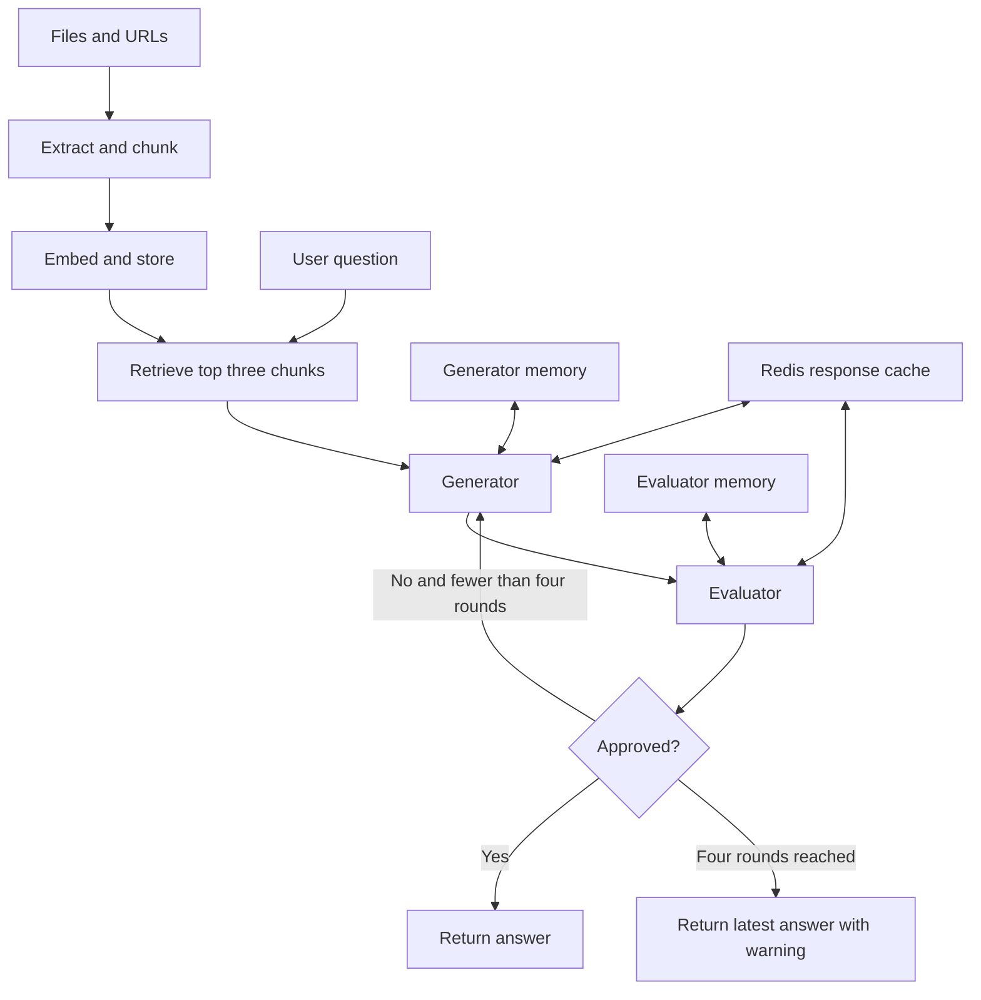

# Task 6: Generator-Evaluator Knowledge Assistant

A Streamlit application that answers questions from uploaded documents,
source code, web/Wikipedia pages, and WAV recordings. A Generator creates an
answer and an independent Evaluator approves it or supplies correction feedback.
The workflow stops on approval or after a maximum of four rounds.

## Deployed app

Open the [Knowledge Assistant on Streamlit Community Cloud](https://cellula-tech-task-6.streamlit.app/).

Upload your knowledge sources, click **Process sources**, and ask questions using
the chat interface.

## Setup on Windows

Use Python 3.11, Git, Docker Desktop with the Linux engine running, and LibreOffice
for legacy `.ppt` ingestion. Python packages alone cannot read binary PPT files.
Download LibreOffice from https://www.libreoffice.org/download/download-libreoffice/.
PPTX ingestion does not require LibreOffice.

From the project root in a VS Code **Command Prompt** terminal:

```cmd
py -3.11 -m venv .venv
.\.venv\Scripts\activate.bat
python -m pip install -r requirements.txt
python -m pip check
docker compose up -d
docker compose exec redis redis-cli ping
```

For an existing environment, activate it and run the installation/check commands;
there is no need to create a new environment. Redis should respond with `PONG`.
Compose binds Redis to `127.0.0.1:6379` and stores its data in a Docker volume.

Create a root `.env` using `.env.example` as a guide. When updating an existing
project, retain the current `.env` and API key.

```dotenv
OPENROUTER_API_KEY=your_existing_key
OPENROUTER_MODEL=dots-studio/dots-3-note-preview:free
REDIS_URL=redis://127.0.0.1:6379/0
```

Use a general-purpose model with native JSON-schema support for the Evaluator.
The free endpoint is rate limited and its availability can change. The currently
selected free endpoint lists a retirement date of December 31, 2026; choose another
schema-capable model when necessary. Both agents read the same model setting.
Never commit `.env` or a real API key.

LibreOffice is detected through PATH and standard installation locations. If it
is installed elsewhere, add its executable to `.env`, for example:

```dotenv
LIBREOFFICE_PATH=C:/Program Files/LibreOffice/program/soffice.com
```

Start the local application:

```cmd
python -m streamlit run app.py --server.address 127.0.0.1
```

Open the displayed localhost URL. Upload files, enter URLs (one per line), click
**Process sources**, and ask a question. Processing new sources starts a new
conversation. The first use downloads the embedding tokenizer/model and, for
WAV input, the Whisper model. Subsequent uses can read the downloaded files.

## Streamlit Community Cloud

See [STREAMLIT_DEPLOYMENT.md](STREAMLIT_DEPLOYMENT.md) for applying this update to
an already deployed app. The app, Generator, Evaluator, and Redis diagnostic now
read the same `REDIS_URL`. Its default remains the local Docker endpoint; set a
hosted Redis URL in Streamlit Secrets for cloud deployment. The hosted service
must support JSON.GET/JSON.SET. Upstash Redis provides a free option with TLS and
these commands; use its Redis/TCP connection rather than its HTTPS REST endpoint.
Root `packages.txt` installs LibreOffice Impress in Community Cloud, and the
Windows `LIBREOFFICE_PATH` should stay local. No cache-data migration is needed.

For WAV uploads, `requirements.txt` pins faster-whisper 1.2.1 and PyAV 18.1.0.
PyAV 19 removed an argument passed by this released decoder, causing
`open() got an unexpected keyword argument 'metadata_errors'`. See
[AUDIO_DEPENDENCY_FIX.md](AUDIO_DEPENDENCY_FIX.md) for updating a deployed app and
opening its Cloud logs. No system FFmpeg installation is needed for this fix.

## Supported knowledge sources

| Input | Processing | Source information retained |
| --- | --- | --- |
| PDF | Extract page text with pypdf | Original filename and page |
| DOCX | Extract body paragraphs and tables | Original filename |
| TXT and supported source-code/text extensions | Decode UTF-8 text | Original filename |
| PPTX | Extract slide text, tables, and grouped shapes | Original filename and slide |
| PPT | Convert automatically to PPTX with LibreOffice, then extract | Original PPT filename and slide |
| HTML web page | Download bounded HTML and extract main/article text | URL and title |
| Wikipedia URL | Prefer the article body | URL, title, and Wikipedia source type |
| WAV | Transcribe with faster-whisper base on CPU, then chunk | Filename, language, and segment timestamps |

Supported code extensions are listed in `ingestion.TEXT_EXTENSIONS`. PDF and slide
images are not OCR inputs; image-only files produce a clear extraction error.
Web ingestion accepts HTML pages, not direct PDF-download URLs, browser sessions,
or JavaScript-rendered application state. Download a PDF URL and upload the file.
A GitHub page is ingested as a page; this does not recursively download a repository.

The UI accepts up to 10 files and 5 URLs, up to 20 MB per file and 50 MB combined,
and rejects source collections producing more than 2,000 chunks. Web downloads
have a 5 MB content limit. PPT conversion has a 120-second timeout, uses its own
temporary LibreOffice profile, and leaves the uploaded file unchanged.

## Architecture and workflow



- Ingestion uses LCEL `RunnableLambda` stages. `rag_workflow.py` composes retrieval
  and the answer/evaluation operation through LCEL. Each agent is an LCEL chain;
  `workflow.py` implements the explicit bounded loop inside that operation.
- `all-MiniLM-L6-v2` embeddings are normalized and stored in an in-memory vector
  store. Chunks target 220 embedding-tokenizer tokens, with 30 tokens of overlap
  where normal recursive splitting permits it. Every final chunk is checked
  against the model's 256-token limit, including special tokens. Metadata includes
  a character `start_index` pointing to the actual source substring.
- The current question retrieves up to three passages. The same passages are used
  throughout its revision loop. Questions should name their subject explicitly;
  retrieval does not rewrite ambiguous follow-ups such as "What about its limits?".
- The Generator is instructed to use supplied evidence, state when information is
  unavailable, and treat Evaluator feedback as correction guidance rather than
  source evidence.
- The Evaluator checks accuracy, relevance, completeness, and grounding. It requests
  a strict JSON schema containing a boolean `approved` and nonempty `feedback`.
  Client-side acceptance also validates the **untouched response text** and normal
  completion metadata. Repaired partial JSON, truncated completions, invalid types,
  extra fields, and blank feedback cannot authorize approval or enter its cache.
- Valid rejected assessments are cacheable too. Malformed/unfinished assessments
  become unvalidated rejections and consume a normal round. Four such rounds return
  the latest candidate with a warning. They do not trigger hidden evaluator retries.
- Separate `AgentMemory` objects and message lists store each agent's own history.
  Each receives only its own list through its history placeholder. Explicitly passing
  evaluation feedback to the Generator is part of the required workflow.
- Streamlit copies session memories for an attempt and commits them when the workflow
  completes. Provider/transport failures are displayed as errors, and incomplete
  attempts do not replace the session's committed agent memories.

## Redis and request configuration

`redis_config.py` reads `REDIS_URL` from the environment (or the local root `.env`)
for every Redis client. The URL supplies authentication, host, port, and database;
`rediss://` enables TLS. Keep the URL in Secrets because it can contain a password.
The connection helper sets five-second connection/read timeouts. The diagnostic
`python -m test_files.check_redis` verifies both connectivity and the JSON commands
required by the cache, then removes only its own temporary probe.

Each answer includes a **Cache** expander beside **Evaluation feedback** and
**Sources**. It lists the actual Generator and Evaluator lookup status for every
round, plus total hits and misses. Mixed results are shown separately. These are
the lookups recorded when that answer was produced; rerendering the page does not
turn an earlier miss into a hit. Cache details also remain visible if a provider
request fails. Request-local reporting keeps concurrent sessions separate.

`LoggedRedisCache` uses exact model-input/configuration matching. The Generator and
Evaluator use separate namespaces; the updated Evaluator uses `task6:evaluator:v3`.
Entries expire after 3,600 seconds. Older Evaluator namespaces are left to expire;
do not clear Redis to apply this update. Invalid existing entries are treated as
misses, without requiring deletion.

Question text, passage text/metadata, model settings, and message history can affect
the cache key. Repeating a question inside an ongoing conversation can miss because
history changed. To demonstrate a hit, clear the conversation, ask a question, wait
for completion, clear it again, and paste the identical question with sources unchanged.
The terminal should show hits for both agents. `Clear conversation` does not clear Redis.

Both models use an explicitly configured OpenRouter SDK client: `timeout_ms=60000`
and `retry_config=None`. This avoids the default SDK backoff that remains active
when integration version 0.2.9 is given only `max_retries=0`. The timeout supplies
60-second transport phase/inactivity limits, not a guaranteed wall-clock deadline.
Each agent has a 4,096-completion-token cap. Four normal rounds perform at most eight
client chat requests when no cache hits occur; SDK retries are disabled.

## Commands and verification

Run from the project root with the virtual environment activated. Diagnostic scripts
under `test_files` use module invocation:

```cmd
python -m test_files.check_memory
python -m test_files.check_llm
python -m test_files.check_redis
python -m unittest discover -s tests -v
```

`check_memory` and the regression suite are offline. `check_llm` makes one live model
request using the root `.env`. `check_redis` connects to the configured Redis endpoint.
The regression suite uses synthetic SDK responses,
test doubles for Redis I/O, the real LangChain parsing path, and mocked HTTP transport.
It does not overwrite existing Redis entries or download models.
Warning messages about invalid assessments are expected in these synthetic tests;
the test summary should end with `OK`.

Verify automatic legacy PPT conversion with the included benign two-slide fixture:

```cmd
python ingestion.py test_files\fixtures\legacy_demo.ppt
```

It should extract the maximum of four iterations and the description of Redis caching.
You can also upload this file through the UI and ask about the maximum iteration count.

Other existing entry points remain available:

```cmd
python generator.py
python generator.py
python evaluator.py
python workflow.py
python rag_workflow.py data\Task-6.pdf --question "What is the maximum number of iterations?"
python rag_workflow.py --url "https://en.wikipedia.org/wiki/Cache_(computing)" --question "What is a cache hit?"
python rag_workflow.py data\audio_demo.wav --question "What is the maximum number of iterations?"
```

Use file paths that exist locally. The two Generator invocations demonstrate a
cache miss followed by a hit when their inputs/settings have not already been cached.

## Versions and current scope

The behavior-sensitive dependencies are pinned in `requirements.txt`: LangChain Core
1.7.1, langchain-openrouter 0.2.9, OpenRouter SDK 0.11.46, langchain-redis 0.2.6, and
Pydantic 2.12.5, faster-whisper 1.2.1, and PyAV 18.1.0. The update's automated checks were run under Python 3.12.14 with these
versions. Real tokenizer/chunk tests and real LibreOffice conversion were also run.
The Cache panel was checked with Streamlit 1.66.1 AppTest for completed answers,
provider-error messages, older messages without cache data, and page reruns.
The Windows Python 3.11 environment still needs the installation and smoke checks above.

The application is intended for a trusted local demonstration. URL fetching does not
restrict private destinations or validate every redirect; apply destination controls
before allowing untrusted users to submit URLs. Agent histories currently last for
the session without a trimming budget. The embedding model is reconstructed when
sources are processed, and documents are re-embedded. Histories, the vector store,
and uploaded temporary files are not persistent across an app restart. Redis is the
persistent cache, not the agent-memory store or a permanent document database.

The update adds cache visibility and a configurable deployment endpoint without
changing which inputs match in Redis. The 31 offline regression checks passed;
they include local endpoint defaults, TLS/password URL parsing, both agent clients,
and a JSON-capability diagnostic. Real audio decoding tests cover mono input and
stereo downmixing/resampling without downloading Whisper weights. The uploaded WAV
reproduced the PyAV 19 failure and decoded successfully with the pinned version.
The real Whisper base model and application audio-ingestion chain also transcribed
the supplied WAV successfully into one chunk, with source/timestamp metadata.
A live hosted Redis or Streamlit deployment was
not accessed during these checks; perform the deployment smoke checks above.
